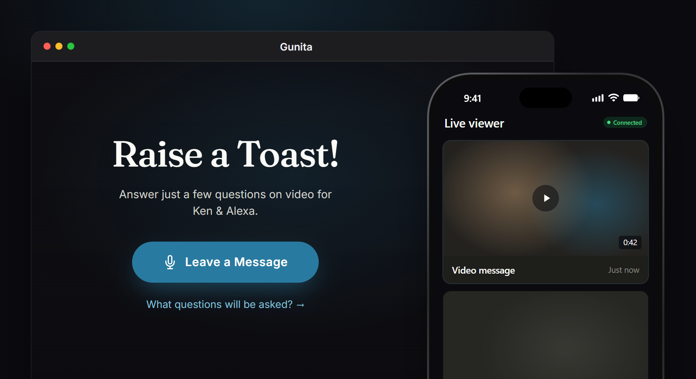

<p align="center">
  
</p>

# Gunita



Gunita is an event kiosk that runs in the browser. Guests walk up, tap **Leave a Message**, and answer a few questions on camera. At the end they can also take a photo strip. Everything is saved to the device and, if you connect it, to Google Drive. The hosts can watch new messages come in from their phones.

It's a PWA, so you can install it on an iPad or a laptop and run it full screen at the venue. Fonts, icons and libraries are bundled, so it keeps working when the Wi-Fi doesn't.

Try it at https://iamfercatapang.github.io/Gunita/.

## What it does

- Guests record video answers to prompts you write, such as "What's your best advice for the couple?", and can redo a take. You can put an overlay frame on the video.
- After the video, guests are offered the photo booth. Layouts cover 2×6 strips and 4×6 or 5×7 prints, portrait or landscape, with one to four photos, and you can add your own template background.
- Files go to a folder you pick on the device (File System Access API) or download if the browser can't do that. Google Drive upload is optional. If the Wi-Fi drops, uploads wait in the browser's storage and go out when the connection comes back, even after a reload.
- Hosts can follow along on their phones: scan a QR code or open the link, and each capture shows up as it's made. This runs peer to peer over PeerJS.
- A PIN keeps guests out of the admin side. It's stored as a PBKDF2 hash.
- The admin dashboard is where you set up the welcome screen, prompts, layouts, overlays, the disclaimer, the PIN and the live viewer. The welcome screen page shows a preview while you edit.

## Getting started

You need Node 20 (see `.nvmrc`).

```bash
npm ci
npm run dev
```

The dev server runs at http://localhost:5173.

For Google Drive, copy `.env.example` to `.env.local` and set `VITE_DRIVE_CLIENT_ID` to an OAuth client ID (web application) from Google Cloud. Add `http://localhost:5173` and your production URL as authorized JavaScript origins. If you leave it unset, the build falls back to the client ID in `src/constants/index.ts`.

| Script | What it runs |
|---|---|
| `npm run dev` | Vite dev server |
| `npm run build` | Typecheck, then a production build into `dist/` |
| `npm run preview` | Serve `dist/` on your network |
| `npm run typecheck` | `tsc --noEmit` |
| `npm run lint` / `lint:fix` | Biome |

## How the code is laid out

Gunita started as one big `app.js`. It's being moved to typed modules a piece at a time, and the app has kept working at each step.

- `public/app.js`: the original app, still in charge of the screens and the capture flow. It loads as a plain script.
- `src/main.ts`: the Vite entry. It bundles jQuery, PeerJS and the fonts, then puts the typed modules on `window.PB` for `app.js` to call.
- `src/lib/`: the typed modules.
  - `drive/`: Google Drive client and upload queue
  - `audio/`: mic monitor, Bluetooth output, beeps
  - `devices/`: camera and mic lists
  - `security/`: kiosk PIN
  - `live-viewer/`: PeerJS host and viewer
  - `capture/`: camera, frame compositing, saving files
- `src/state/` and `src/constants/`: app settings and the photo layouts.
- `src/styles/`: design tokens (`tokens.css`, `themes.css`) and the redesigned screens.

CI runs lint, typecheck and build on every push and pull request to `main` and `Dev`. Pushes to `Dev` deploy to GitHub Pages.

## Roadmap

- [x] Phase 1: Vite, TypeScript and Biome around the existing app
- [x] Phase 2: move Drive, audio, devices, security, the live viewer and capture into `src/lib`
- [x] Phase 3: redesign every guest and admin screen on shared design tokens: welcome, photo booth, recording, done screen, admin dashboard and the live viewer
- [ ] Phase 4: move the screens out of `app.js` into React
